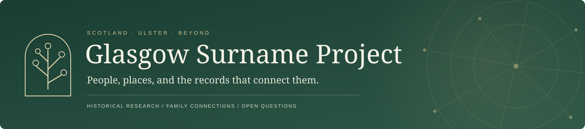
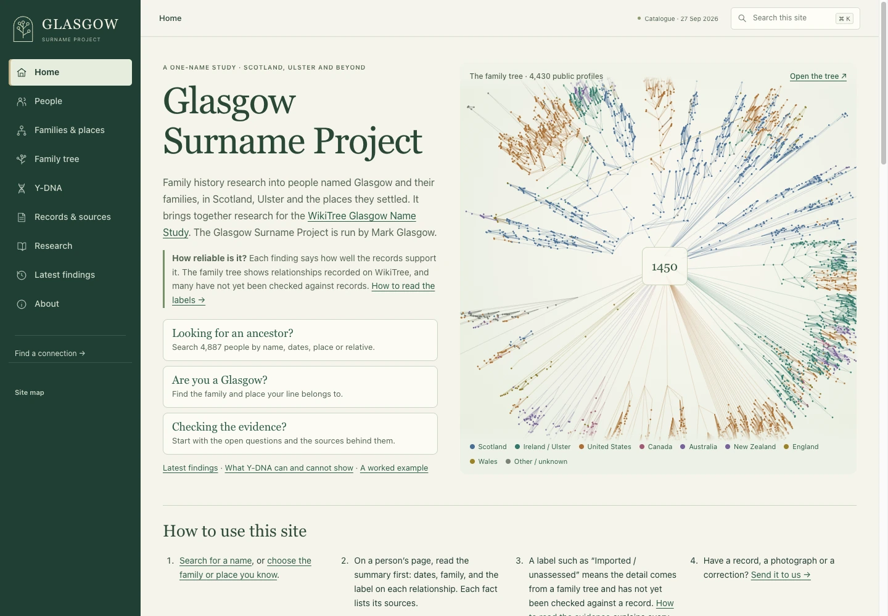
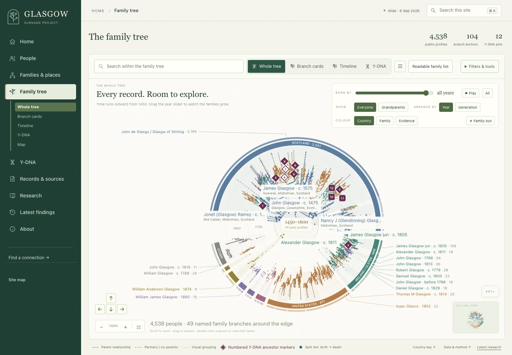
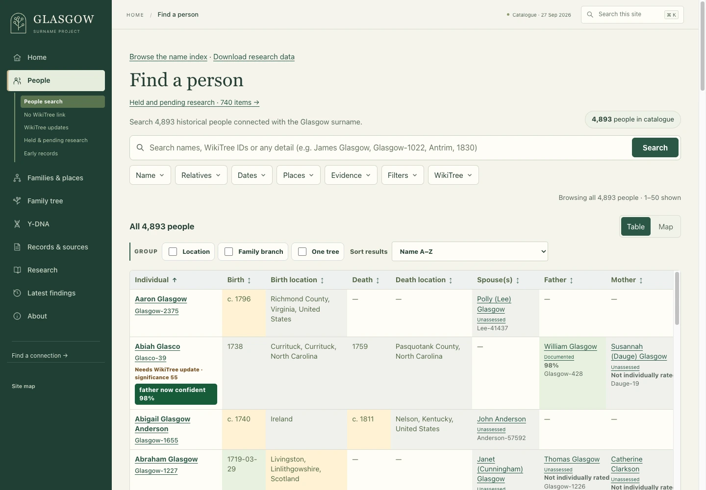
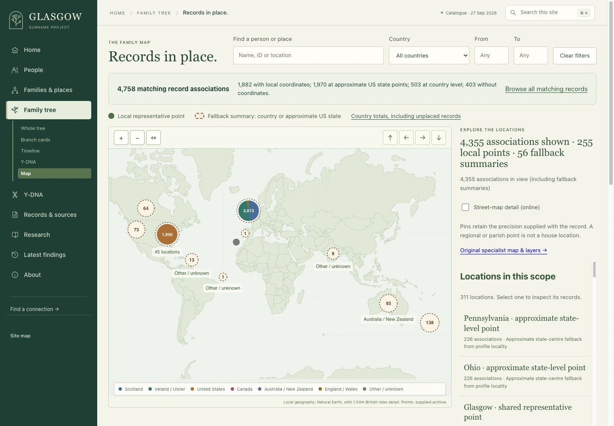
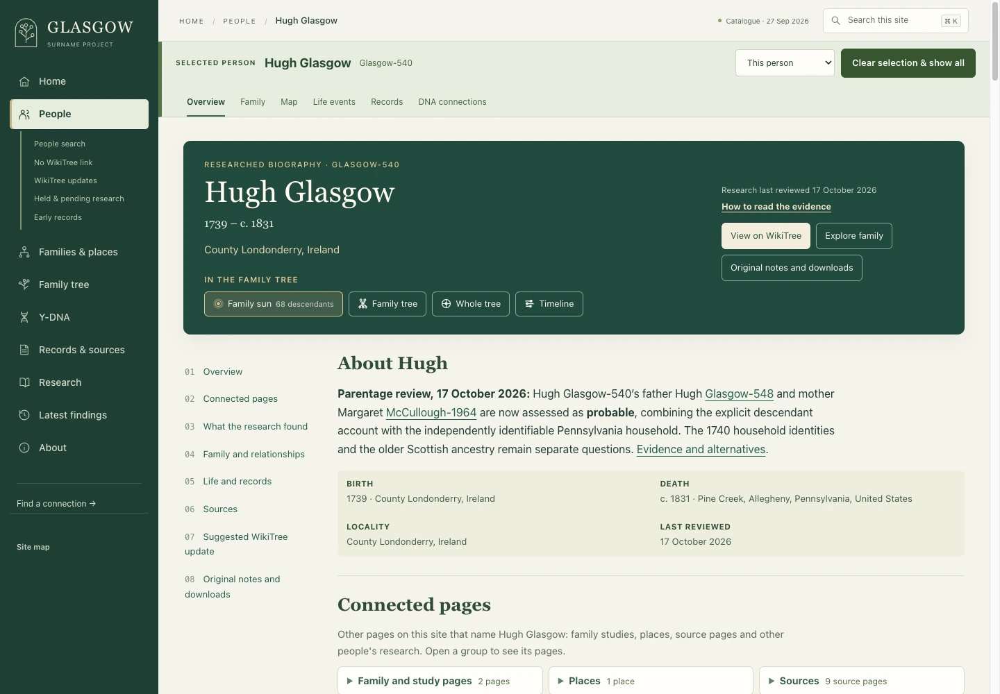
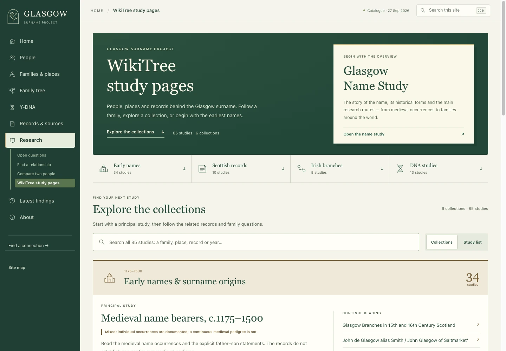
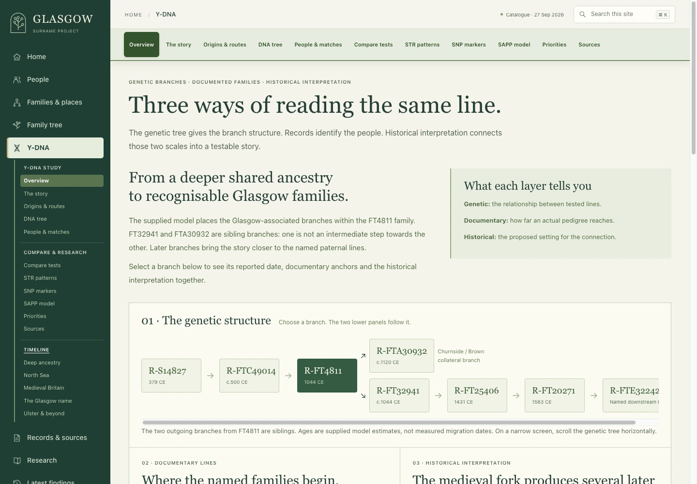
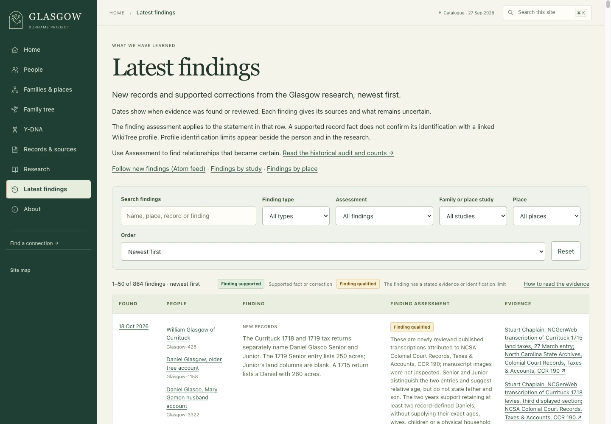

<div align="center">



**One surname. Centuries of records. Thousands of connected lives.**

[Explore the website](https://glasgow.phenotype.dev/) · [Take the tour](#a-look-around) · [Run locally](#get-started) · [Research workflow](docs/research-workflow.md)

[](https://github.com/glasgowm148/glasgow-surname-ancestry/actions/workflows/ci.yml)


</div>

The **Glasgow Surname Project** follows people named Glasgow and its variants through Scotland, Ulster, and the places their families settled. It brings together historical records, family reconstruction, WikiTree research, and Y-DNA interpretation in a public, searchable website.

Behind the site is a Python research workbench: durable cases, source citations, relationship assessments, profile drafts, and tools that turn those findings into connected pages. The question running through it all is simple: **what do the records actually support?**

[](https://glasgow.phenotype.dev/)

## A look around

### A whole family tree, with room to explore

Zoom from the complete tree into a household. Switch between the whole tree, branch cards, timeline, and Y-DNA views; follow named family branches and open the people behind the dots.

[](https://glasgow.phenotype.dev/onetree/)

<table>
<tr>
<td width="50%" valign="top">
<h3>Find a person</h3>
<a href="https://glasgow.phenotype.dev/catalogue/"></a>
<p>Search thousands of historical people by name, dates, place, relatives, and evidence. See relationship assessments and outstanding WikiTree amendments alongside the results.</p>
</td>
<td width="50%" valign="top">
<h3>Put records on the map</h3>
<a href="https://glasgow.phenotype.dev/map/"></a>
<p>Explore where people were recorded, from local places to country summaries. Location precision stays visible, so a regional point is never mistaken for an exact address.</p>
</td>
</tr>
<tr>
<td width="50%" valign="top">
<h3>Read the evidence</h3>
<a href="https://glasgow.phenotype.dev/people/glasgow-540.html"></a>
<p>Person pages connect family, sources, current conclusions, and unresolved questions. Supported relationships and uncertain hypotheses retain their own labels.</p>
</td>
<td width="50%" valign="top">
<h3>Follow a study</h3>
<a href="https://glasgow.phenotype.dev/free-space/"></a>
<p>Browse sourced studies by family, place, period, or topic. The local WikiTree study edition brings related records and research questions into one reading experience.</p>
</td>
</tr>
<tr>
<td width="50%" valign="top">
<h3>Connect DNA and documentary research</h3>
<a href="https://glasgow.phenotype.dev/ydna/"></a>
<p>Explore paternal-line branches, comparisons, and research priorities, with genetic estimates, documented ancestry, and historical interpretation explained separately.</p>
</td>
<td width="50%" valign="top">
<h3>See what changed</h3>
<a href="https://glasgow.phenotype.dev/latest-findings/"></a>
<p>The latest-findings log connects discoveries to the people and sources they concern. Follow a new conclusion back to the fuller current account.</p>
</td>
</tr>
</table>

Screenshots were captured from the local website on **19 October 2026** at 1440 × 1000. They show those pages’ individual data snapshots; the live site may differ. Select an image to visit its corresponding page.

**More ways in:** [Families & places](https://glasgow.phenotype.dev/branches/) · [Records & sources](https://glasgow.phenotype.dev/sources/) · [Find a connection](https://glasgow.phenotype.dev/connections/) · [Compare people](https://glasgow.phenotype.dev/compare/) · [How to read the evidence](https://glasgow.phenotype.dev/evidence/)

## How the research becomes a website

```text
Historical records + WikiTree captures
                  ↓
Research cases · citations · questions · relationship assessments
                  ↓
Canonical research catalogue
                  ↓
People · family tree · maps · studies · latest findings
                  ↓
Reviewed profile drafts and WikiTree amendments
```

Findings keep their provenance, confidence, and open questions. A relationship imported from a tree is a research lead until assessed against records. Local profile drafts and comparisons make proposed amendments reviewable before a live WikiTree edit.

This repository owns the Glasgow research, branding, website, and source policies. Shared genealogy models, adapters, and the reusable site builder live in the independent [**genealogy-research-workbench**](https://github.com/glasgowm148/genealogy-research-workbench) repository, pinned here as a Git submodule; [`genealogy.toml`](genealogy.toml) defines the project overlay. To build a site from your own GEDCOM or OneTree file, start with the [toolkit’s v0.2.0 release](https://github.com/glasgowm148/genealogy-research-workbench/releases/tag/v0.2.0). See the [toolkit boundary](docs/toolkit-migration.md).

## Get started

**Want to browse?** [Open the public website](https://glasgow.phenotype.dev/)—no installation needed.

**Want to work on the project?** Use Python **3.11+**, Git, and Make. From a terminal:

```bash
git clone --recurse-submodules https://github.com/glasgowm148/glasgow-surname-ancestry.git
cd glasgow-surname-ancestry
python3 -m venv .venv
source .venv/bin/activate
python -m pip install -r requirements/base.txt -r requirements/dev.txt -c requirements/constraints.txt
make check
```

The base requirements install the toolkit from its pinned Git submodule. For an existing clone, first run `git submodule update --init --recursive`. A separate editable toolkit checkout is optional; see [dependency updates](docs/toolkit-dependency.md). `make check` runs Ruff, data validation, and offline tests, plus research-publication and site-link checks when their local inputs are available.

### Preview an existing local website

The complete generated `www/` site and its raw input datasets are **not included in a fresh clone**. If you have the built site locally, serve it over HTTP so root-relative links and data requests resolve:

```bash
python -m http.server 8000 --bind 127.0.0.1 --directory www
```

Open [localhost:8000](http://localhost:8000/). Use the [build and deployment guide](docs/public-catalogue-deployment.md) when preparing the full site from local data. Builds and deployment are separate steps; there is no automatic deployment.

### Start a WikiTree research case

The normal capture workflow uses the WikiTree API. It does not require a logged-in browser.

```bash
python src/wikitree_family_export.py Glasgow-1538 \
  --research-dir research/Glasgow-1538 \
  --descendant-depth 2
```

Depth 2 captures the subject and each child; those family responses also index the grandchildren. A case keeps a compact brief, a durable findings log, a research plan, an evidence index, and immutable raw captures.

Continue with the [research workflow](docs/research-workflow.md) for evidence standards and publication, or the [command-line guide](docs/command-line.md) for imports, queued targets, optional FamilySearch capture, and toolkit handoffs.

## Useful commands

Run from the repository root with `.venv` activated. Build commands require the corresponding local datasets.

| Task | Command |
| --- | --- |
| Standard quality gate | `make check` |
| Offline unit tests | `make test` |
| Research → website consistency | `make check-research` |
| Built-site internal links | `make check-links` |
| Browser smoke check without private data | `python -m playwright install chromium` then `python tools/check_site_quality.py --fixture-smoke` |
| Browser checks against the built site | `make check-browser` |
| Regenerate surname research indexes | `python src/surname_research_index.py` |
| Read the project configuration | `python tools/genealogy_project.py` |
| Refresh One-Tree data and rebuild the catalogue/map | `make build` |

`make build` can regenerate thousands of pages. For ordinary research changes, use the targeted builders in the [website synchronization guide](docs/website-research-sync.md). For incremental WikiTree refreshes and advanced exporter recipes, see the [command-line guide](docs/command-line.md#checks-and-website-builds).

## Find your way through the repository

| Location | What lives there |
| --- | --- |
| [`research/`](research/) | Individual research cases, findings, and profile drafts |
| [`surname-research/INDEX.md`](surname-research/INDEX.md) | Surname-wide research, locality clusters, and relationship hypotheses |
| [`src/`](src/) | WikiTree exporter and surname research indexing |
| [`tools/`](tools/) | Site builders, synchronization, validation, and research utilities |
| [`tests/`](tests/) | Offline regression tests and browser checks |
| [`data/`](data/) | Maintained inputs and local datasets; raw exports stay untracked |
| [`www/`](www/) | Built website and selected maintained site files |
| [`vendor/genealogy-research-workbench/`](vendor/genealogy-research-workbench/) | Independent toolkit Git submodule, pinned to a reviewed commit |

## Read next

| Guide | Use it for |
| --- | --- |
| [Research workflow](docs/research-workflow.md) | Starting a case, assessing evidence, and preparing supported amendments |
| [Command-line recipes](docs/command-line.md) | Export/import, research iteration, browser capture, refreshes, and toolkit integration |
| [Website research synchronization](docs/website-research-sync.md) | Keeping findings, catalogue, drafts, and public views aligned |
| [Evidence labels](docs/evidence-labels.md) | Understanding status, confidence, and provenance |
| [Repository structure](docs/repository-structure.md) | Detailed ownership and directory layout |
| [Research tooling](docs/genealogy-tooling.md) | Local search, source integrations, setup, and rollback |
| [Toolkit dependency](docs/toolkit-dependency.md) | Initialisation, local development, upgrades, and release order |
| [Build reproducibility](docs/build-reproducibility.md) | Build inputs, ordering, and repeatability |
| [Deployment](docs/public-catalogue-deployment.md) | Release preparation and live verification |
| [Privacy policy](docs/privacy-policy.md) | What can appear in public outputs |

## Contribute a record, correction, or improvement

For research, include the original source citation, the person or family it concerns, what it supports, and what remains uncertain. Keep namesakes and competing parent hypotheses distinct. For code or presentation changes, include reproduction steps and run the checks relevant to the change.

[Open an issue](https://github.com/glasgowm148/glasgow-surname-ancestry/issues) or [review the WikiTree Glasgow Name Study](https://www.wikitree.com/wiki/Space:Glasgow_Name_Study).

**Public by design, selective by necessity.** Code, documentation, and durable historical research belong here. Living-person information, credentials, raw DNA, browser state, raw captures, and restricted or licensed source material do not belong in public outputs. The complete generated website and raw datasets stay local, as defined in [`.gitignore`](.gitignore) and the [privacy policy](docs/privacy-policy.md).
